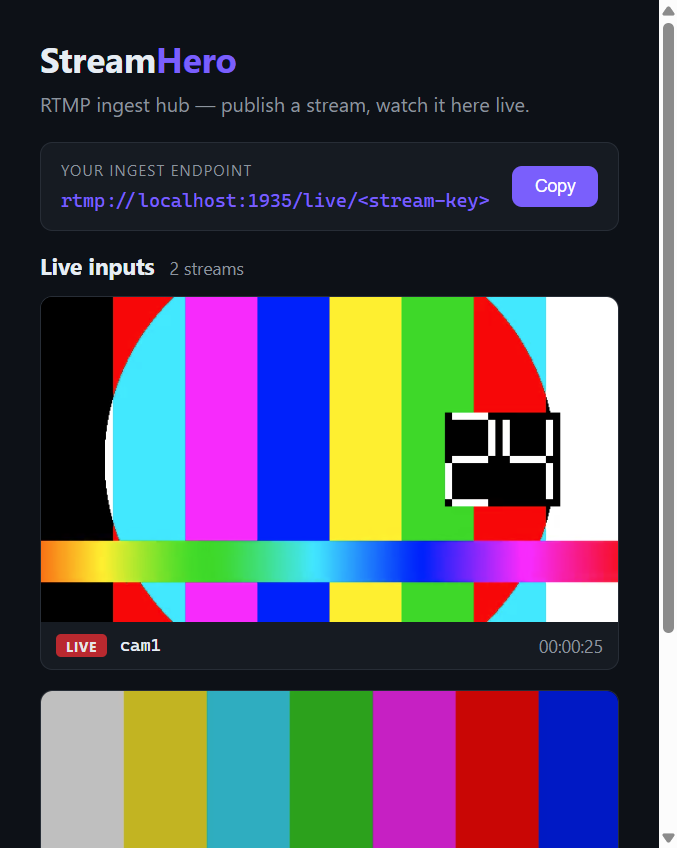
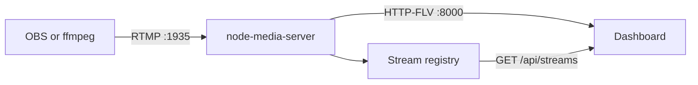

<h1 align="center">StreamHero</h1>

<p align="center">
  Self-hosted live production. Publish every camera over RTMP and watch them all, live, in one browser.
</p>

<p align="center">
  <a href="LICENSE"></a>
  
  
</p>

<p align="center">
  
</p>

StreamHero runs on a machine you control. Point OBS or ffmpeg at the ingest
endpoint and each camera shows up as its own live card, with a stream key and
a running clock. No account, no cloud studio.

It is aimed at solo streamers and small crews who want to see every input
before they direct a show. Switching, transitions, graphics, recording,
restream, and multi-tenant director mode are the work ahead, listed in
[ROADMAP.md](ROADMAP.md).

## What works today

| Bring cameras in | Watch them live | Keep them apart |
| --- | --- | --- |
| RTMP from OBS or ffmpeg on port `1935` | Each input plays in the dashboard within a couple of seconds | A different stream key is a different input |
| As many publishers as the machine can hold | Live badge, stream key, and uptime on every card | Cards appear when a publisher connects and leave when it drops |
| The ingest URL is on the dashboard, ready to copy | Playback is HTTP-FLV through [flv.js](https://github.com/bilibili/flv.js) | A JSON API lists whoever is live right now |

## Quickstart

Node.js 18 or newer.

```bash
npm install
npm start
```

Open the dashboard at http://localhost:3000. You should see your ingest endpoint at the top and an empty stage until the first camera connects.

| | |
| --- | --- |
| Dashboard | http://localhost:3000 |
| RTMP ingest | `rtmp://localhost:1935/live/<your-stream-key>` |
| HTTP-FLV playback | `http://localhost:8000/live/<your-stream-key>.flv` |

Ports live in [`server/config.js`](server/config.js). Change them there if `1935`, `8000`, or `3000` is already taken.

## Publish a camera

**OBS.** Settings, Stream, Service: Custom.

- Server: `rtmp://localhost:1935/live`
- Stream key: any name you want, such as `cam1`

**ffmpeg.** A file, a capture card, or a test pattern all use the same URL.

```bash
ffmpeg -re -i input.mp4 -c copy -f flv rtmp://localhost:1935/live/cam1
```

A second camera is the same command with another key. Both cards show up side by side.

```bash
ffmpeg -re -i input2.mp4 -c copy -f flv rtmp://localhost:1935/live/cam2
```

Give each physical camera its own key (`cam1`, `cam2`, `guest`) and the dashboard becomes the wall of inputs you direct from.

## How a frame gets to the browser



[node-media-server](https://github.com/illuspas/Node-Media-Server) accepts the RTMP publish and remuxes it to HTTP-FLV. Express serves the dashboard and the API on port `3000`. The page polls `/api/streams` every few seconds, opens a player for each new publisher, and tears the player down when that publisher disconnects.

## API

`GET /api/streams` returns whoever is publishing right now.

```json
{
  "streams": [
    {
      "name": "cam1",
      "path": "/live/cam1",
      "sessionId": "53GPTKWZ",
      "startedAt": 1710000000000
    }
  ]
}
```

`GET /api/config` returns the ports and app name the dashboard uses to build the ingest and playback URLs.

```json
{ "rtmpPort": 1935, "flvPort": 8000, "app": "live" }
```

## Project layout

```
server/     RTMP ingest, the live registry, and the JSON API
public/     Dashboard: HTML, CSS, and the player logic
docs/       Notes and the dashboard screenshot
```

## What is next

The ingest wall is the foundation. The rest of the product is sketched in [ROADMAP.md](ROADMAP.md):

- Switch the program between inputs live, with a cut, dissolve, or fade
- Put images and subtitles on the output
- Record the program and any single input
- Restream to YouTube, Instagram, and other RTMP targets
- A director seat, with viewers, publishers, and an explicit take-over
- Separate studios (multi-tenant) and an admin panel

## License

[MIT](LICENSE). Copyright (c) 2026 Mohammad Reza Salehi.
